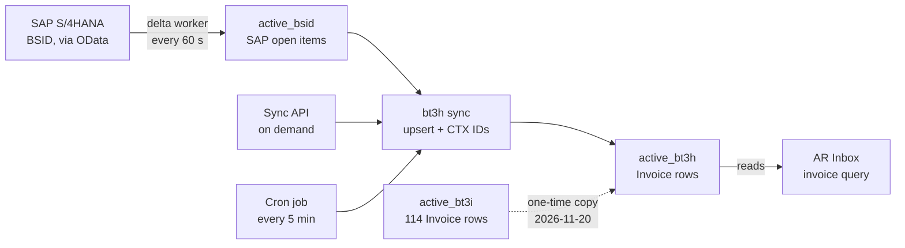

# SAP Invoice Sync to active_bt3h — Deployment & Cron Guide

As of 2026-11-20

## Overview

SAP open AR invoices now land in **active_bt3h**, not active_bt3i. The delta worker keeps `active_bsid` current every minute; a new cron job copies it into `active_bt3h` every 5 minutes, so the AR Inbox sees a new SAP invoice within about 6 minutes.

- **Source:** `active_bsid` (SAP BSID, open customer items), kept up to date by the delta worker.
- **Target:** `active_bt3h`, rows with `processcode = 'BT3H'`, `themename = 'IT_Invoice'`, `transactiontype = 'Invoice'`.
- **Why the move:** the AR Inbox invoice query is to read from `active_bt3h`. All 114 existing Invoice rows of `active_bt3i` were copied there on 2026-11-20; `active_bt3i` itself is unchanged.
- **Project:** `sap-extraction-api` (FastAPI + CLI), deployed at `/opt/sap-extraction-api` on the EC2 host. It is not under git; the pre-change script is kept as `sync_bsid_to_bt3i.py.bak_20261120`.



The delta worker keeps `active_bsid` current; the cron job (or a call to the sync API) runs the sync into `active_bt3h`, which the AR Inbox query reads. `active_bt3i` fed `active_bt3h` once, on 2026-11-20.

## Components

Three things run on the server: the API (systemd), the delta worker (systemd) and the cron jobs. The bt3h sync itself is a library file that the API and the cron job call.

| Role | File | How it runs on the server | Writes to |
| --- | --- | --- | --- |
| API | `main.py` | systemd `sap-extraction-api.service` → `uvicorn main:app --host 127.0.0.1 --port 8002 --workers 1` | depends on endpoint; `POST /api/transform/bt3i` → `active_bt3h` |
| Delta worker | `worker.py` (started as `cli.py worker`) | systemd `sap-extraction-worker.service`, always on, `Restart=always` | `active_bsid` every 60 s (`[delta] poll_seconds`) |
| Cron wrapper | `deploy/run_cron.sh` → `cli.py <command>` | `crontab -e` as the service user `sapapp` | whatever the command does |
| bt3h sync logic | `sync_bsid_to_bt3i.py` (function `sync_bsid_to_bt3h`) | never on its own; called by the cron job and the API | `active_bt3h` |
| Pipeline glue | `pipeline.py` (`run_bt3i_sync`, `transform_bt3i`) | imported by `cli.py` and `main.py` | — |

The CLI command (`sync-bt3i`) and the API path (`/api/transform/bt3i`) still carry the old name; both write to `active_bt3h`. The old function name `sync_bsid_to_bt3i` is kept as an alias so existing callers work.

## Cron schedule

Add one new job: `sync-bt3i` every 5 minutes. Without it nothing writes to `active_bt3h` automatically, because the daily `sync` skips BSID (it is delta-managed) and `run_bt3i_sync = false` in config.ini. Times below assume the EC2 clock is UTC (IST = UTC + 5:30).

| Job | Cron expression | Runs at (UTC) | Runs at (IST) | What it does | Status |
| --- | --- | --- | --- | --- | --- |
| bt3h sync | `*/5 * * * *` | every 5 min: :00, :05 … :55 | every 5 min (:30, :35 … :25 past the IST hour) | `active_bsid` → `active_bt3h` upsert, CTXSAP context IDs for new invoices | **New — add** |
| Daily full load | `30 0 * * *` | 00:30 daily | 06:00 daily | Full load of non-delta `[sap]` tables; BSID is skipped | Existing, unchanged |
| Delta cycle (fallback) | `* * * * *` | every minute | every minute | `delta-poll` + `ingest`; only when the systemd worker is not used | Existing, commented out |
| Delta worker | — (systemd, not cron) | every 60 s | every 60 s | SAP BSID → `active_bsid` (new / changed / removed rows) | Existing, unchanged |

Crontab for the service user (`sudo -u sapapp crontab -e`):

```bash
# SAP extraction cron jobs (server clock: UTC). 00:30 UTC = 06:00 IST.
# Exit codes: 0 ok, 1 failed, 2 partial, 75 skipped (previous run still holds the lock).
# Detailed log: /opt/sap-extraction-api/log/cron.log ; JSON result of each run: log/cron.out

# NEW: active_bsid -> active_bt3h (SAP open AR invoices) every 5 minutes
*/5 * * * * /opt/sap-extraction-api/deploy/run_cron.sh sync-bt3i >> /opt/sap-extraction-api/log/cron.out 2>&1

# Existing: full loads of the other [sap] tables once a day at 06:00 IST
30 0 * * * /opt/sap-extraction-api/deploy/run_cron.sh sync >> /opt/sap-extraction-api/log/cron.out 2>&1
```

**Overlap and locking**

- `sync-bt3i`, the daily `sync` and the API extract endpoints share one file lock (`pipeline`). If one is running, the next `sync-bt3i` exits with code **75** and does nothing; the run 5 minutes later picks it up.
- The delta worker uses its own lock (`delta_<table>`), so it never blocks the bt3h sync.
- A run takes about 3–6 seconds for ~60 invoices (measured on dev, 2026-11-20), so 5 minutes leaves wide headroom.
- Every run is an upsert: running more often (`*/1`) or less often (`0 * * * *`, hourly) never creates duplicates or changes existing context IDs; it only changes how fast new SAP invoices appear.

## Data rules

Each open SAP customer invoice line in `active_bsid` becomes one `active_bt3h` row; the primary key is `(processcode, themename, transactiontype, orgid, documentnumber, sno)`.

**Which rows are picked from active_bsid**

- Debit lines (`shkzg = 'S'`) or document types `DR`, `RV`, `DG`, `AB`.
- Amount in company-code currency (`dmbtr`) greater than 0.
- Rows the delta poller marked `sap_status = 'REMOVED'` (cleared in SAP) are skipped.
- Optional filters: company code (`--company-code`), org and tenant (`--org-id`, `--tenant-id`; defaults from `[defaults]` in config.ini: `OM0000000001` / `DM00005`).
- Exact duplicates (every selected column identical) are dropped.

**Column mapping**

| active_bt3h column | Value | SAP source (active_bsid) |
| --- | --- | --- |
| `processcode` / `themename` / `transactiontype` | `BT3H` / `IT_Invoice` / `Invoice` | fixed |
| `orgid`, `tenant_id` | org / tenant of the run | config or CLI |
| `documentnumber` | invoice reference; falls back to the SAP document number | `xblnr`, else `belnr` |
| `sno` | 1, 2, … per `documentnumber` | line counter |
| `documentid` | SAP accounting document number | `belnr` |
| `grouptransactionref` | context ID `CTXSAP<org2><FY><seq7>`, one per SAP document | generated |
| `documentdate` / `postingdate` | dates | `bldat` / `budat` |
| `sendername` / `senderaccount` | customer name / number | `kna1.name1` / `kunnr` |
| `basevalue`, `documentvalue`, `totalbasevalue`, `totaldocumentvalue` | invoice amount | `dmbtr` |
| `currency`, `transactioncurrency`, `localcurrency` | currency | `waers` |
| `tdsvalue`, `adjustedamount`, `taxpercentage` | 0 | — |
| `linkref` | partner reference (UTR) | `xref1` |
| `documenttype` / `source_table` | `Invoice` / `active_bsid` | fixed |

**Upsert behaviour on re-runs**

- New invoice → inserted; a new CTXSAP context ID is reserved from the `MASTEROBJECTSEQUENCINGV2` sequence.
- Existing invoice → amounts, dates, customer, currency and `documentid` are refreshed from SAP.
- Never overwritten once set: `grouptransactionref` (context ID), `tdsvalue`, `adjustedamount`. Context IDs already present in `active_bt3h` or in the old `active_bt3i` rows are reused.
- `linkref` is only replaced when SAP sends a value.
- Rows are never deleted: an invoice cleared in SAP stays in `active_bt3h` with its last values.

## One-time changes already applied (dev DB dm00005)

On 2026-11-20 the dev database (`dm00005`, port 5433) got 5 new `active_bt3h` columns and a full copy of the `active_bt3i` Invoice rows. Any other database the server uses needs step 2 of the deployment before the first sync.

1. **Schema** — added to `active_bt3h` (the AR Inbox query reads them; types match `active_bt3i`):

    ```sql
    ALTER TABLE public.active_bt3h
      ADD COLUMN IF NOT EXISTS grouptransactionref text,
      ADD COLUMN IF NOT EXISTS basevalue double precision,
      ADD COLUMN IF NOT EXISTS documentvalue double precision,
      ADD COLUMN IF NOT EXISTS tdsvalue double precision,
      ADD COLUMN IF NOT EXISTS adjustedamount double precision;
    ```

2. **Copy** — every `active_bt3i` row with `transactiontype = 'Invoice'` was upserted into `active_bt3h`: all 87 columns both tables share, `processcode` set to `BT3H`, `sgstpercentage` cast to text. `active_bt3i` was not changed.
3. **Sync run** — the updated script ran once more to fill the SAP invoices that were never in `active_bt3i`.

| Result | Count |
| --- | --- |
| `active_bt3i` Invoice rows copied | 114 (60 uploaded, 54 from SAP) |
| … inserted as new rows | 61 |
| … overwrote rows from the first sync run (same invoices) | 53 |
| `active_bt3h` Invoice rows after copy + sync | 119 |
| New CTXSAP context IDs reserved (`CTXSAP0126270000176` – `…179`) | 4 |
| Rows without a context ID | 0 |
| `active_bt3i` Invoice rows missing from `active_bt3h` | 0 |

## Deployment steps (EC2, /opt/sap-extraction-api)

Two files change on the server (`sync_bsid_to_bt3i.py`, `pipeline.py`), plus one crontab line; the API and worker only need a restart. Run as a user with sudo; files are owned by `sapapp`.

1. **Back up the current files on the server**

    ```bash
    cd /opt/sap-extraction-api
    sudo cp sync_bsid_to_bt3i.py sync_bsid_to_bt3i.py.bak_$(date +%Y%m%d)
    sudo cp pipeline.py pipeline.py.bak_$(date +%Y%m%d)
    ```

2. **Add the 5 columns in the server's database** — skip if it is the dev DB `dm00005` (already done). Run the `ALTER TABLE` from *One-time changes* above with `psql` or any SQL client. Without it every sync fails with "column grouptransactionref does not exist".
3. **Copy the changed files** from `C:\sap-extraction-api` (README.md is optional):

    ```bash
    # from the workstation
    scp sync_bsid_to_bt3i.py pipeline.py README.md <user>@<ec2-host>:/tmp/
    # on the server
    sudo install -o sapapp -g sapapp -m 644 /tmp/sync_bsid_to_bt3i.py /tmp/pipeline.py /tmp/README.md /opt/sap-extraction-api/
    sudo -u sapapp /opt/sap-extraction-api/.venv/bin/python -m py_compile /opt/sap-extraction-api/sync_bsid_to_bt3i.py /opt/sap-extraction-api/pipeline.py
    ```

4. **Check config.ini on the server** — `[defaults] org_id` and `tenant_id` are the org/tenant the rows are written for. `[sap] run_bt3i_sync` can stay `false`; the cron job calls the sync directly.
5. **Restart the services** so the API and worker load the new code:

    ```bash
    sudo systemctl restart sap-extraction-api sap-extraction-worker
    systemctl status sap-extraction-api sap-extraction-worker --no-pager
    ```

6. **Run the sync once by hand** and expect exit code 0 with `target_table : active_bt3h`:

    ```bash
    sudo -u sapapp /opt/sap-extraction-api/deploy/run_cron.sh sync-bt3i; echo "exit=$?"
    ```

7. **Install the cron job** — `sudo -u sapapp crontab -e` and add the `*/5` line from *Cron schedule*.
8. **Watch the first scheduled run** after the next 5-minute mark: `tail -f /opt/sap-extraction-api/log/cron.out` (one JSON result per run) and `log/cron.log` (details).

## Verification

The deployment is good when a manual run exits 0, the cron log shows a result every 5 minutes, and the AR Inbox query returns rows from `active_bt3h` with no empty Context_ID.

**Trigger a sync on demand**

```bash
# CLI (same as the cron job)
sudo -u sapapp /opt/sap-extraction-api/deploy/run_cron.sh sync-bt3i

# API (port 8002, local only; X-API-Key = [api] api_key in config.ini)
curl -s -X POST http://127.0.0.1:8002/api/transform/bt3i \
  -H "X-API-Key: <api key>" -H "Content-Type: application/json" -d '{}'
```

The result lists `invoices_found_in_bsid`, `invoices_upserted_to_bt3h` and `total_bsid_invoices_in_bt3h`; the log line `Context IDs: N reused, M newly generated` shows the context-ID step.

**SQL checks**

```sql
-- 1. SAP invoices synced into bt3h, newest first
SELECT documentnumber, documentid, grouptransactionref, documentdate, sendername,
       documentvalue, currency, modifieddatetime
FROM active_bt3h
WHERE processcode = 'BT3H' AND transactiontype = 'Invoice' AND source_table = 'active_bsid'
ORDER BY modifieddatetime DESC;

-- 2. Last sync time (should be under 5 minutes old)
SELECT max(modifieddatetime) FROM active_bt3h
WHERE processcode = 'BT3H' AND source_table = 'active_bsid';

-- 3. Invoice rows without context or amount (expected: 0)
SELECT count(*) FROM active_bt3h
WHERE transactiontype = 'Invoice'
  AND (grouptransactionref IS NULL OR basevalue IS NULL OR documentvalue IS NULL);

-- 4. Open SAP invoices not yet in bt3h (expected: 0 right after a sync)
SELECT b.belnr, b.xblnr FROM active_bsid b
WHERE COALESCE(b.shkzg, '') = 'S' AND COALESCE(b.sap_status, '') <> 'REMOVED'
  AND NOT EXISTS (SELECT 1 FROM active_bt3h h
                  WHERE h.processcode = 'BT3H' AND h.documentid = b.belnr);
```

**AR Inbox query** — the existing query works on `active_bt3h` with one change, `FROM active_bt3i a` → `FROM active_bt3h a`. On dev it returned 119 rows, all with a Context_ID (`active_bt3i` returns 114).

## Rollback and troubleshooting

To go back to writing `active_bt3i`, restore the backed-up script and remove the cron line; the rows already in `active_bt3h` stay unless deleted on purpose.

**Rollback**

```bash
cd /opt/sap-extraction-api
sudo -u sapapp crontab -e        # delete the */5 sync-bt3i line
sudo cp sync_bsid_to_bt3i.py.bak_<YYYYMMDD> sync_bsid_to_bt3i.py
sudo cp pipeline.py.bak_<YYYYMMDD> pipeline.py
sudo systemctl restart sap-extraction-api sap-extraction-worker
```

The 5 added columns can stay; nothing else reads or requires them. Removing the synced rows is a separate, deliberate step (filter `processcode = 'BT3H' AND themename = 'IT_Invoice' AND transactiontype = 'Invoice'`); check with the AR Inbox owner first.

**Troubleshooting**

| Symptom | Likely cause | Fix |
| --- | --- | --- |
| `column "grouptransactionref" of relation "active_bt3h" does not exist` | Step 2 (ALTER TABLE) not run on this database | Run the ALTER TABLE, then the sync again |
| Exit code 75, "Another SAP extraction / sync is already running" | Daily `sync` or an API extract holds the `pipeline` lock | Nothing; the next 5-minute run catches up. If it repeats for hours, look for a stuck process holding the lock |
| `records_processed: 0`, "No invoice records found in active_bsid" | Delta worker stopped, or SAP has no open invoices | `systemctl status sap-extraction-worker`, `cli.py delta-status` |
| New SAP invoice not in the AR Inbox after 10 minutes | Cron job missing or failing | `sudo -u sapapp crontab -l`, then `tail log/cron.out` and `log/cron.log` |
| Context ID missing on a new row | Sequence reservation failed | Error is in `log/cron.log` under `SAP_Pipeline.Context`; re-run the sync |
| Invoice still shown after it was paid in SAP | By design: the sync never deletes rows | See *Known limitations* |

## Known limitations and open decisions

- **Cleared invoices are not removed.** An invoice paid in SAP drops out of `active_bsid` but its `active_bt3h` row stays. On dev, 59 SAP rows sit in `active_bt3h` against 58 open in `active_bsid`.
- **Uploaded invoices still go to active_bt3i.** The 2026-11-20 copy was one-time; invoices created later outside SAP (UI upload, other jobs) are written to `active_bt3i` only.
- **active_bt3i keeps its 114 Invoice rows.** They are no longer refreshed by the sync.
- **The bank-clearing API (sap-bank-clearing-api) updates documentid in active_bt3i only.** SAP-sourced rows in `active_bt3h` already carry `documentid`, so they need nothing; uploaded invoices would.
- **Old names remain.** CLI `sync-bt3i`, API `/api/transform/bt3i`, config `run_bt3i_sync` and the file name all still say bt3i.
- **No version control.** `C:\sap-extraction-api` is not a git repository; the backups above are the only history.
- **The one-time copy is not part of the project.** Another database needs the 114-row copy as well as the ALTER TABLE; the copy script exists only on the workstation that ran it.

Open decisions:

- [ ] Delete cleared invoices from `active_bt3h` on each sync, or keep them?
- [ ] Point the AR Inbox query (and any other reader) at `active_bt3h`.
- [ ] Route new uploaded invoices to `active_bt3h` as well?
- [ ] Rename `sync-bt3i` / `/api/transform/bt3i` to bt3h names?
